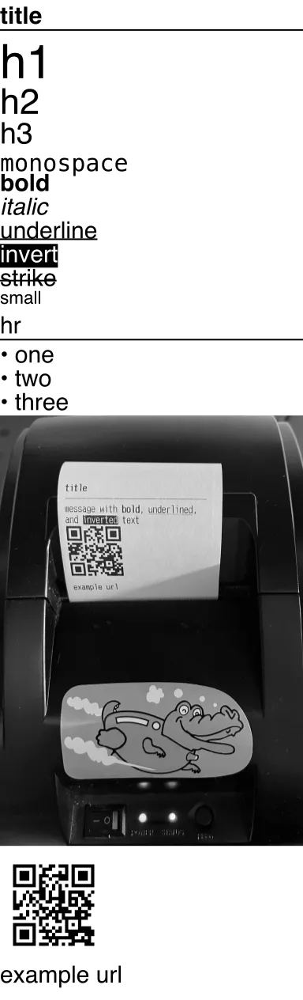

# Setup
1. copy `sample.config.json` to `config.json` and set each variable as needed
2. run `npm run start`
3. send a test notification via [pushover.net](https://pushover.net/) or by running `npm run notify`

# Compatibility Notes
For 3rd-party clients, Pushover does *not* send attachments (e.g. images). To get around this without violating the api restrictions, this client supports the appropriate html tags for attachments. Images should be sent via ``. Other attachments may use `<video>`, `<audio>`, `<embed>`, or `<object>` as appropriate. Please note that these tags are unsupported by and may crash official clients.

